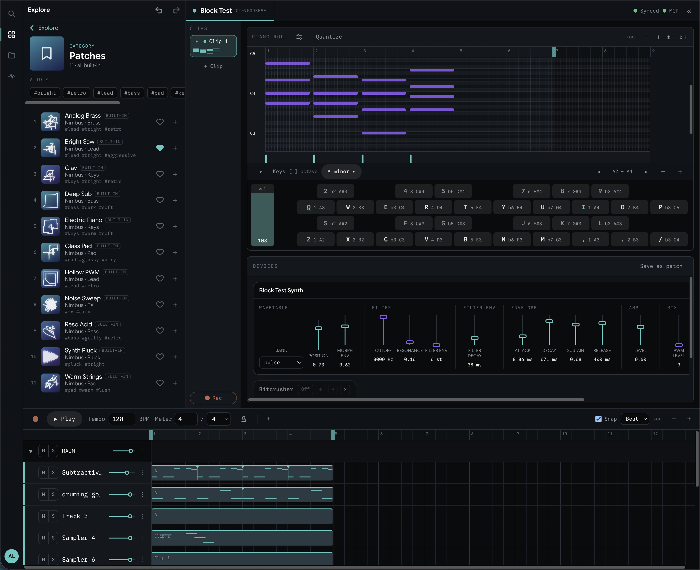
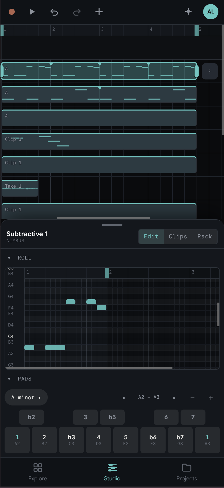

<p align="center">
  
</p>

# Corrente

A music studio in the browser, built on an open, declarative format for instruments and effects.
Play, arrange and record on a desktop, a tablet or a phone, together with other people and with AI
agents, in the same live project.

<table align="center">
  <tr>
    <th>Desktop</th>
    <th>Phone</th>
  </tr>
  <tr>
    <td></td>
    <td></td>
  </tr>
</table>

## Why Corrente

- **An open, declarative standard for instruments and effects.** A device is data: a graph of
  oscillators, filters, envelopes and samples, with the controls it exposes. Anyone can write one,
  and an AI agent can build a new instrument or effect in minutes through the MCP tools, then play
  it straight away. The UI, the MCP tools, automation and saved patches are all views of the same
  parameter schema, so a new device works everywhere at once.
- **Live, multiplayer and multi-device** (in the online version). Open the same project on your
  laptop and your phone, or with friends, and every edit arrives everywhere as it happens, with
  each person's changes in their own colour.
- **Built to be shared.** Projects open from a link and can be shared with collaborators today.
  Publishing your own instruments, patches and projects for the community to find in Explore is
  where it is heading, to grow the best open-source ecosystem of devices and sounds.
- **Agents are collaborators, not add-ons.** Every edit is an authored, replayable command, so an
  agent edits the same project the same way you do, its changes are marked as its own, and undo and
  history cover them too.
- **Nothing to install.** It runs in the browser, works offline once loaded, and installs as an app
  on a phone.

**Try it online at [web-daw.fly.dev](https://web-daw.fly.dev).** The online version adds accounts,
sync between devices, live collaboration, sharing and a hosted MCP server. Sign-in is invite-only
while it is in preview; everything in this repo also runs on its own, with projects kept in your
browser.

## What it does

- **Instruments:** subtractive, FM, supersaw, organ, Mellotron, wavetable, Nimbus, a sampler and
  a drum kit, plus patches to start from and your own saved ones.
- **Effects:** delay, reverb, distortion, filter, chorus, tremolo and bitcrusher, in a chain per
  track or group.
- **MIDI devices** that reshape notes before the instrument: octavator, arpeggiator and a Euclidean
  rhythm generator.
- **An arrangement timeline** with clips and loops, a piano roll, a drum roll, and grooves for swing.
- **Recording** from the computer keyboard, a MIDI controller, on-screen pads or a microphone.
- **Explore:** every instrument, patch, effect and sample in one place, to try before adding it.
- **History:** undo that survives a reload, and named versions to go back to.
- **On a phone or tablet:** a touch layout with playable scale and chord pads. Installable, and it
  works offline.
- **Projects** live in your browser, and export and import as `.daw.zip` files.

## Working with an AI assistant

- **From Claude (or any MCP client):** `yarn mcp-server` is a local MCP server that drives the app
  open in your browser. It can make tracks, write and edit notes, set parameters, mix, and save versions. In
  Claude Code, this repo's `.mcp.json` starts it for you.
- **In the app:** an assistant panel that uses your own API key (Gemini, OpenAI or Anthropic).

## Architecture at a glance

- **Web Audio API** for the audio graph; **AudioWorklets** for all custom DSP (sample-accurate, on the audio thread).
- **DSP written once** as plain JS pure functions over `Float32Array`, shared between an offline `.wav` test renderer and the shipped worklet (no port-twice drift).
- **MCP is a control-plane, not the realtime path**: it's another client of the parameter model, never a direct line to the audio thread.
- **Edits are commands**: every change is an authored, replayable command, which is what undo, history and the AI tools all share.

## Stack

Vite + React + TypeScript.

## Development

This project uses [Yarn Classic](https://classic.yarnpkg.com/) (v1).

```bash
yarn             # install dependencies
yarn dev         # start the dev server
yarn dev:mobile  # serve over https on the LAN, for testing on a real device
yarn build       # type-check and build for production
yarn lint        # lint
yarn test        # run tests
```

### Testing on a phone or tablet

Use `yarn dev:mobile` and open the `https://<lan-ip>:5155/` address it prints. Do **not**
just use `yarn dev --host`: an origin that is plain http and is not `localhost` is an
**insecure context**, and three things the app depends on are gated on a secure one.

| API | Gated | Symptom on plain http |
| --- | --- | --- |
| `AudioWorklet` | yes | nothing plays; the start dialog now says why |
| `navigator.storage` (OPFS) | yes | persistence silently falls back to memory |
| `getUserMedia` | yes | no mic recording |
| `crypto.randomUUID` | yes | (handled - see `src/audio/randomUuid.ts`) |

The certificate is self-signed, so the device shows a warning once: on iOS, **Show Details
-> visit this website**; on Android Chrome, **Advanced -> Proceed**. The certificate is
cached, so this is a one-off per device rather than per run.

`ERR_EMPTY_RESPONSE` means the browser asked for `http://` and the server only speaks TLS -
usually the address bar autocompleting a remembered plain-http URL. Type the `https://`
prefix explicitly.

`dev:mobile` runs in Vite's `test` mode, which loads the committed `.env.test` and so blanks
`VITE_SUPABASE_*` and `VITE_DAW_API_URL`. That skips the login gate and persists locally to
OPFS, which is what you want for UI work. To exercise the real backend from a device instead,
run `MOBILE_HTTPS=1 yarn dev --host` so your own `.env` applies.

If the device cannot reach the laptop at all (client isolation on the network), tunnel
instead - `cloudflared tunnel --url https://localhost:5155` - the tunnel hostnames are
already in `allowedHosts`.

### Installing it as an app

The app is installable (MOBILE-3): a manifest, icons, and a service worker that precaches the
whole shell so it starts with no network.

**`yarn dev:mobile` cannot show you this**, for two separate reasons, and each on its own is
enough:

1. **There is no manifest or worker on the dev server.** They are generated for a real build
   only (`devOptions.enabled: false`, so a stale worker can never serve the test suite). Nothing
   is installable there however the origin is served.
2. **A self-signed certificate is not enough.** A browser declines to register a service worker
   on a certificate it does not trust, and says nothing at all about it: no install prompt, no
   error. Fine for everything above, useless here.

**So install it from a deployed build**: put `yarn build`'s `dist/` on any HTTPS host (a static
host is enough for the standalone app), then open that URL on the phone. Chrome Android offers
**Install app** in its menu, iOS Safari **Share -> Add to Home Screen**.

That is not a workaround for the local setup, it is the shorter path. Serving a build locally
over a certificate a phone will trust means either a tunnel or a private CA, and either way what
you end up testing is a build - so it may as well be the build everyone else gets, on the origin
it will actually run on. The service worker's scope, the manifest's `start_url` and the API it
talks to are all origin-shaped, and only the deploy has the real ones.

Two things that surprise people:

- An installed app is a **separate storage bucket** from the browser tab it was installed from,
  so its OPFS projects start empty. It is a different app as far as the browser is concerned.
- There is **no live reload**. It is a build; rebuild and reload to see a change, and the worker
  hands over the new version on the load after that.

`yarn check:pwa` answers the offline question without a device at all: it serves `dist/`,
installs the worker, cuts the network and asks for a route the browser has never seen. CI runs
it after the build.

## Contributing

Contributions are welcome. By submitting a change you certify the
[Developer Certificate of Origin](CONTRIBUTING.md) by signing off your commits
(`git commit -s`), and grant the maintainer the right to relicense your
contribution ([details](CONTRIBUTING.md#licence-grant)). See
[CONTRIBUTING.md](CONTRIBUTING.md) for everything else.

## License

[GNU AGPL-3.0-or-later](LICENSE).

In short: the source is open and you are free to use, modify, and self-host it,
but if you run a modified version as a network service you must publish your
changes under the same license. The copyright holder may also offer the project
under a separate commercial license; reach out if the AGPL does not fit your use.
